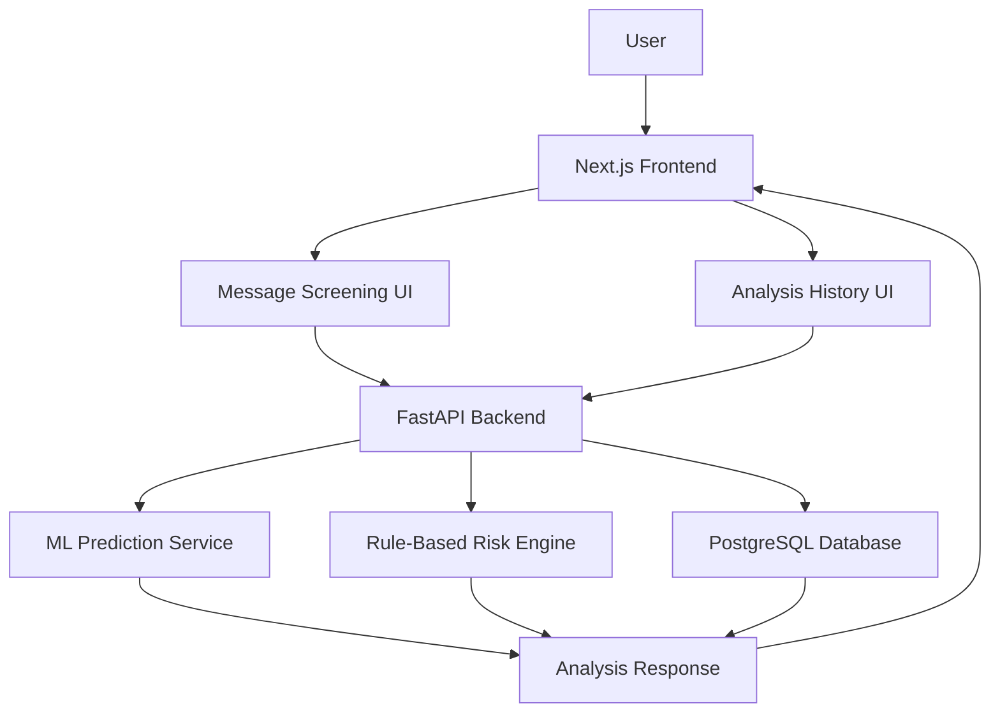

# ScamShield KE — Frontend

**An AI-powered message screening platform for identifying potentially suspicious SMS messages, job advertisements, and online offers.**

[](https://scamshield-frontend-ecru.vercel.app/)
[](https://nextjs.org/)
[](https://react.dev/)
[](https://tailwindcss.com/)

## Live Application

**Try ScamShield KE:** https://scamshield-frontend-ecru.vercel.app/

The frontend provides the user-facing interface for submitting messages, viewing screening results, and reviewing previously saved analyses.

The application communicates with a separate FastAPI backend responsible for machine-learning predictions, rule-based risk indicators, and persistent analysis history.

## Related Repositories

- **Frontend:** [ScamShield-frontend](https://github.com/WalterOnchieku/ScamShield-frontend)
- **Backend API:** [ScamShield-backend](https://github.com/WalterOnchieku/ScamShield-backend)
- **Machine Learning Pipeline:** [ScamShield-ml](https://github.com/WalterOnchieku/ScamShield-ml)

## Table of Contents

- [Overview](#overview)
- [Project Objectives](#project-objectives)
- [Features](#features)
- [Technology Stack](#technology-stack)
- [Application Architecture](#application-architecture)
- [Application Pages](#application-pages)
- [Project Structure](#project-structure)
- [Prerequisites](#prerequisites)
- [Local Setup](#local-setup)
- [Environment Variables](#environment-variables)
- [API Integration](#api-integration)
- [Error Handling](#error-handling)
- [Production Deployment](#production-deployment)
- [Security and Privacy Considerations](#security-and-privacy-considerations)
- [Limitations](#limitations)
- [Future Improvements](#future-improvements)
- [Author](#author)
- [License](#license)

## Overview

ScamShield KE is a web-based message-screening application designed to help users recognize potentially suspicious communications before acting on them.

Scams delivered through SMS, unsolicited job offers, prize notifications, suspicious links, and requests for sensitive information can expose users to financial loss, identity theft, and account compromise.

The frontend makes the screening process accessible through a simple workflow:

1. Submit a message for analysis.
2. Receive a machine-learning classification and risk assessment.
3. Review detected warning signs and recommended precautions.
4. Review saved analyses through the history interface.

The application is designed as a separate frontend repository so that its interface can be developed and deployed independently of the backend and ML pipeline.

**Important:** ScamShield KE provides screening assistance, not definitive fraud verification. A high-risk result does not prove that a message is fraudulent, and a low-risk result does not guarantee that it is safe.

## Project Objectives

The frontend is intended to:

- Provide an accessible interface for screening suspicious messages.
- Present machine-learning predictions alongside explainable warning indicators.
- Make analysis results understandable to non-technical users.
- Provide access to previously saved analysis records.
- Handle loading states, invalid input, API failures, and empty results gracefully.
- Demonstrate practical integration between a modern React application and a REST API.
- Support independent frontend deployment through Vercel.

## Features

### 1. Message Screening Interface

Users can enter a message for analysis and submit it to the backend.

The interface includes input validation, a character limit of 5,000 characters, a loading state during analysis, and feedback when a request fails.

Sample messages are available to demonstrate the screening workflow without requiring users to compose their own examples.

### 2. AI-Assisted Risk Assessment

The frontend displays the analysis returned by the backend, including supported fields such as:

- Predicted message classification.
- Spam and ham scores.
- Overall risk level.
- Detected risk indicators.
- Explanations and recommended precautions.
- A disclaimer explaining the limitations of automated screening.

The frontend presents backend results rather than independently calculating classifications.

### 3. Analysis History

The history interface allows users to review previously saved analyses.

Supported functionality includes:

- Retrieving paginated analysis records.
- Filtering records by risk level.
- Viewing analysis summaries.
- Navigating between result pages.
- Displaying loading, error, and empty-result states.

The history interface depends on the backend's persistent storage and history endpoints.

**Deployment consideration:** The current backend history endpoints are not user-scoped. History should not be treated as a private, authenticated personal archive until appropriate authentication and authorization are implemented.

### 4. Responsive Interface

The interface uses a responsive layout intended to work across desktop, tablet, and mobile screens.

The design incorporates a developer-tool-inspired workspace, structured content panels, clear status indicators, and restrained motion effects.

### 5. Motion and Accessibility

Motion effects use Motion for React, with reduced-motion preferences considered where implemented.

The interface should remain usable with keyboard navigation and assistive technologies. Accessibility should be verified during continued UI development.

## Technology Stack

| Technology | Purpose |
|---|---|
| Next.js 16 | React framework, routing, and production builds |
| React 19 | Component-based user interface |
| JavaScript | Application logic |
| Tailwind CSS 4 | Utility-first styling |
| Motion for React | Interface animations |
| Fetch API | HTTP requests to the backend |
| Vercel | Frontend hosting and deployment |
| ESLint | Static code analysis |
| Vitest and Testing Library | Frontend testing tools under development |

Versions reflect the project environment at the time of writing and may change as dependencies are updated.

## Application Architecture

The frontend communicates with the backend through HTTP requests.



### Request Flow

1. A user submits a message through the interface.
2. The frontend validates the input.
3. A `POST /analyze` request is sent to the backend.
4. The backend performs machine-learning prediction and rule-based analysis.
5. The backend persists the analysis record.
6. The response is rendered in the frontend.

For history requests, the frontend retrieves saved records through `GET /history` and related endpoints.

### Separation of Responsibilities

The frontend is responsible for:

- User interaction and input validation.
- Rendering analysis results.
- Displaying errors and loading states.
- Requesting and presenting history records.

The backend is responsible for:

- Request validation and API responses.
- Machine-learning inference.
- Rule-based risk analysis.
- Database operations and persistence.

The ML repository is responsible for dataset preparation, training, evaluation, and model artifact generation.

## Application Pages

| Page | Route | Purpose |
|---|---|---|
| Message scanner | `/` | Submit messages and inspect screening results |
| Analysis history | `/history` | Browse and filter saved analyses |
| Safety guidance | `/safety` | Intended destination for user safety guidance |
| About | `/about` | Intended destination for project information |

The safety and about routes should be considered planned until their implementations are present in the deployed application.

## Project Structure

The main application files follow this structure:

```text
ScamShield-frontend/
├── public/
│   └──                     # Static assets
├── src/
│   ├── app/
│   │   ├── layout.js       # Root layout and metadata
│   │   ├── page.jsx        # Message scanner
│   │   ├── globals.css     # Global styles
│   │   ├── history/
│   │   │   └── page.jsx    # Analysis history
│   │   ├── safety/         # Safety guidance route, if implemented
│   │   ├── about/          # About route, if implemented
│   │   └── __tests__/      # Frontend tests
│   └── lib/
│       └── api.js          # Shared history API helpers
├── .env.local              # Local environment variables; do not commit
├── eslint.config.mjs       # ESLint configuration
├── next.config.mjs         # Next.js configuration, if present
├── package.json
├── postcss.config.mjs
├── vitest.config.mjs       # Vitest configuration, if retained
└── README.md
```

The tree is representative; files may vary as the application evolves.

## Prerequisites

Install the following before running the application locally:

- Node.js compatible with the project's Next.js version.
- npm.
- Git.
- Access to a running ScamShield KE backend or its deployed API.

The current development environment uses Node.js 22 and npm.

## Local Setup

### 1. Clone the repository

```bash
git clone https://github.com/WalterOnchieku/ScamShield-frontend.git

cd ScamShield-frontend
```

### 2. Install dependencies

```bash
npm install
```

### 3. Configure environment variables

Create a `.env.local` file in the repository root:

```dotenv
NEXT_PUBLIC_API_BASE_URL=https://scamshield-backend-6olh.onrender.com
```

Replace the URL if the backend is deployed elsewhere.

For local backend development, use:

```dotenv
NEXT_PUBLIC_API_BASE_URL=http://127.0.0.1:8000
```

Use the URL appropriate for the environment. The local URL assumes the browser can reach the backend on the same machine.

### 4. Start the development server

```bash
npm run dev
```

Open:

http://localhost:3000

### 5. Run a production build

```bash
npm run build
```

To serve the production build locally:

```bash
npm run start
```

The production server uses port 3000 by default unless configured otherwise.

### 6. Run linting

```bash
npm run lint
```

If the repository includes the Vitest test script, run:

```bash
npm test
```

Tests should be considered passing only when the current test suite completes successfully. Refer to the repository's current test configuration for the exact scripts.

## Environment Variables

| Variable | Required | Description |
|---|---|---|
| `NEXT_PUBLIC_API_BASE_URL` | Recommended | Base URL of the FastAPI backend |

The frontend currently has a fallback backend URL in its API configuration. Setting the environment variable explicitly is preferable for local, preview, and production deployments.

**Security note:** Next.js variables prefixed with `NEXT_PUBLIC_` are exposed to browser-side code. Only place public configuration values, such as the API base URL, in these variables. Never store passwords, API secrets, database credentials, or private keys in them.

After changing a production environment variable, rebuild or redeploy the frontend so the new configuration is incorporated into the deployed application.

## API Integration

The application integrates with the ScamShield KE backend.

| Method | Endpoint | Purpose |
|---|---|---|
| `POST` | `/analyze` | Analyze and persist a message |
| `GET` | `/history` | Retrieve saved analyses |
| `GET` | `/history/{analysis_id}` | Retrieve one saved analysis |
| `DELETE` | `/history/{analysis_id}` | Delete a saved analysis |
| `GET` | `/health` | Check backend health |

The history-related frontend helpers are centralized in `src/lib/api.js`.

The scanner currently sends the message as JSON:

```json
{
  "message": "Example message to screen"
}
```

The exact response schema is defined by the backend. The frontend validates important analysis fields before displaying results.

## Error Handling

The interface accounts for common failures, including:

- Empty or oversized messages.
- Failed HTTP requests.
- Backend validation errors.
- Network failures and unavailable services.
- Unexpected response structures.
- History retrieval errors.

For production use, error messages should help users recover without exposing internal stack traces, database details, or sensitive server configuration.

## Production Deployment

The frontend is deployed on Vercel.

**Live URL:** https://scamshield-frontend-ecru.vercel.app/

### Deployment Workflow

1. Push the frontend source code to GitHub.
2. Import the repository into Vercel.
3. Configure the production environment variable `NEXT_PUBLIC_API_BASE_URL`.
4. Ensure the backend permits requests from the deployed frontend origin.
5. Deploy the application.
6. Test message analysis and history retrieval against the production API.

### Backend CORS Configuration

Because the frontend and backend are deployed separately, the backend must allow the frontend's origin through its CORS configuration.

The production frontend origin is:

```text
https://scamshield-frontend-ecru.vercel.app
```

CORS is a browser security mechanism. It does not replace backend authentication or authorization.

### Production Verification Checklist

- [ ] The deployed frontend loads successfully.
- [ ] The frontend uses the correct backend URL.
- [ ] The backend health endpoint responds.
- [ ] Message analysis returns a valid response.
- [ ] Analysis history loads and displays records.
- [ ] Risk-level filters and pagination work.
- [ ] Network and server errors produce useful feedback.
- [ ] The browser console contains no unexpected runtime errors.
- [ ] Mobile and tablet layouts remain usable.

## Security and Privacy Considerations

ScamShield KE is a screening tool and should be treated accordingly.

- Do not submit passwords, PINs, authentication tokens, or other sensitive information for demonstration purposes.
- Do not interpret a model score as a calibrated probability of real-world fraud.
- Do not treat a screening result as definitive proof of legitimacy or fraud.
- Protect history endpoints with authentication and authorization before storing real users' private messages.
- Define retention and deletion policies for persisted analysis records.
- Keep database credentials and private configuration in the backend environment, not in frontend code.
- Use HTTPS for deployed application traffic.

## Limitations

- The quality of the interface depends on backend availability.
- Model performance reflects the dataset and evaluation methodology documented in the ML repository.
- The model was trained on a general SMS spam dataset, not a representative, independently validated collection of Kenyan scams.
- The interface cannot independently verify a sender, a job advertisement, a payment request, or a website.
- Persistent history currently depends on the backend's access-control and database implementation.
- Automated screening can produce false positives and false negatives.

## Future Improvements

Potential improvements include:

- Complete and polish the safety guidance and about pages.
- Add authenticated, user-specific analysis history.
- Improve accessibility and keyboard navigation.
- Expand frontend automated tests.
- Add richer analysis detail views.
- Improve mobile and tablet layout coverage.
- Add clear explanations of model limitations and safe next steps.
- Improve loading, retry, and offline-service messaging.

## Author

**Walter Onchieku**

- GitHub: https://github.com/WalterOnchieku
- LinkedIn: https://www.linkedin.com/in/walter-onchieku-9180b2116/

## License

No license has been specified in this repository documentation. Add a `LICENSE` file before presenting the project as open source under a particular license.
